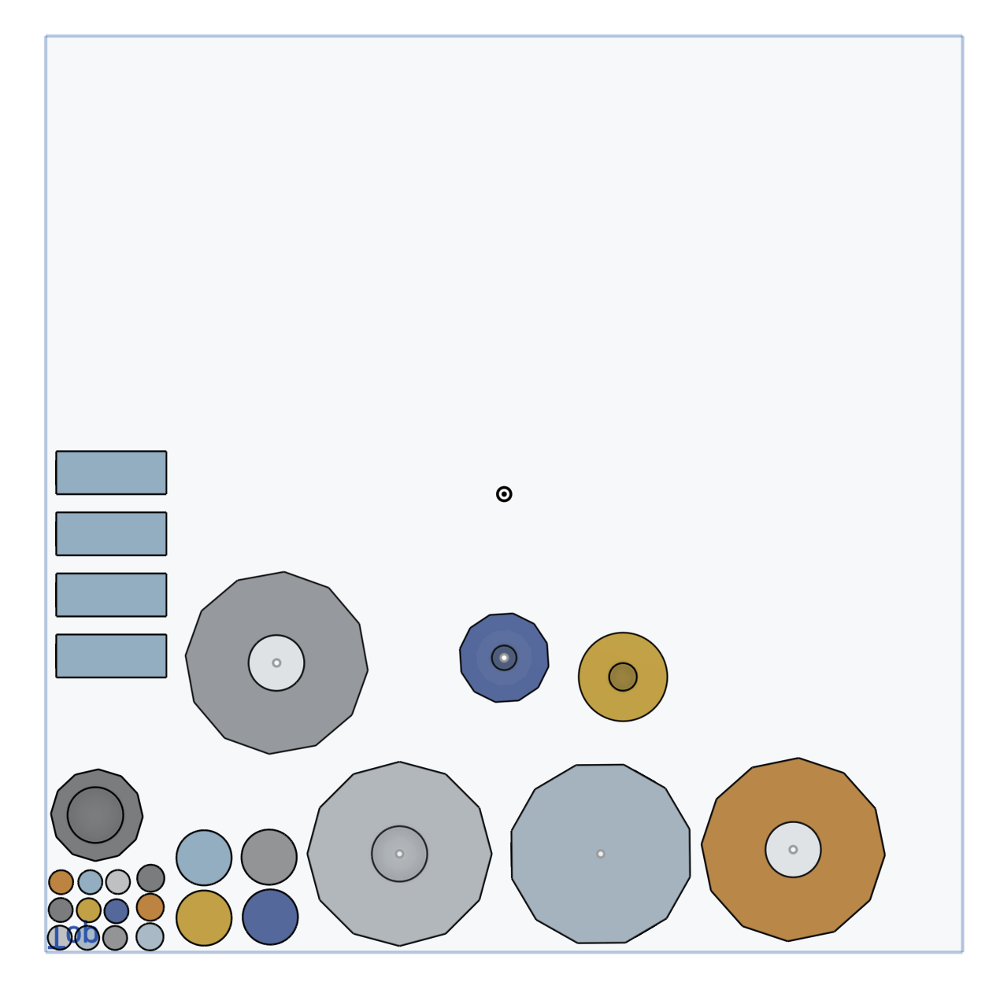
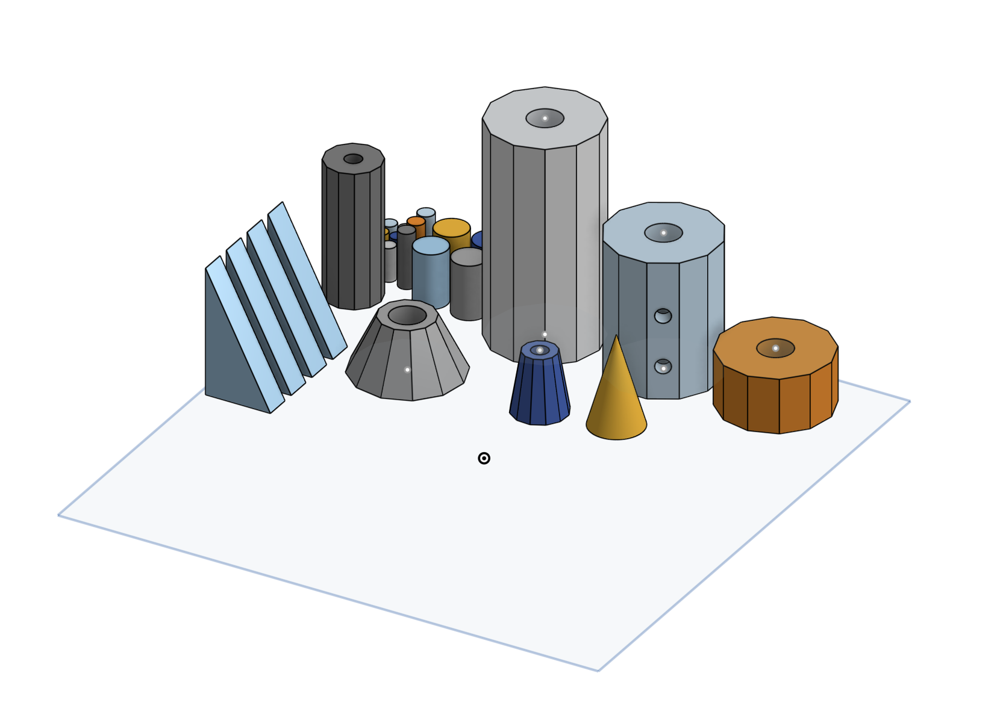
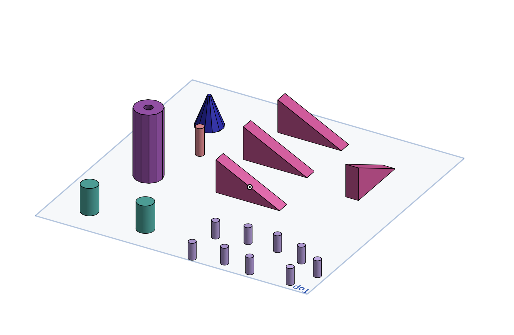

For this assignment, I recreated a modular toy rocket in Onshape and produced it using a 3D printer. The rocket was designed as a press fit construction kit, so its parts could be connected, removed, and rearranged.

## 1. Examining the Original Rocket

At the beginning of the project, we were given a previously printed version of the rocket.

I measured the dimensions of the printed parts. I used these measurements as references while creating my own version in Onshape.

## 2. Creating the Initial Sketches

I started by creating the 2D sketches for the connector pieces. I drew the number of circular connectors that I would need for the complete rocket.

I then created the sketches for the main rocket body parts. These parts were based on 12-sided polygons.

I also drew the base sketches for the parts that gradually became narrower toward the top.

## 3. Designing the Fins

To create the fins, I selected the Front plane and started a new sketch.

I drew the side profile of one triangular fin vertically on this plane. This allowed the fin to have the correct upright orientation.

After completing the sketch, I used the Extrude tool to give the fin its required thickness.

I then used Linear Pattern to create four fin pieces in total. I did not use a pattern for the circular connector pieces because I had already drawn the required number of circles manually.

## 4. Extruding the Parts

After completing the 2D sketches, I used the Extrude tool to turn them into three-dimensional parts.

I entered the required dimensions separately for the connector cylinders using "dimension" tool, 12-sided body sections, fins, and other rocket components.

This created the basic solid parts of the modular rocket.

## 5. Creating the Tapered Parts

Some parts of the rocket needed to gradually become narrower.

I first selected the 12-sided surface at the bottom of one of these parts. I created a new plane above this surface and offset it by the required distance.

On the new plane, I drew another 12-sided polygon. I positioned it so that its center was aligned with the center of the lower polygon.

I then used the Loft tool to connect the two polygons. This created a smooth transition between the larger lower shape and the smaller upper shape.

I repeated this process for the other tapered rocket components.

## 6. Creating the Connection Holes

After modeling the solid parts, I used the Hole tool to create holes in the required surfaces.

The holes were placed according to how the different components would connect when the rocket was assembled.

For the first version, I made the hole diameters 0.15 mm larger than the diameters of the connector pieces. The purpose of this clearance was to create a tight press fit while still allowing the pieces to be assembled.

## 7. Completed Onshape Model

After creating the sketches, extrusions, patterns, lofts, and holes, I completed all the individual rocket components in Onshape.

The design included:

- Cylindrical connector pieces
- 12-sided body sections
- Tapered body sections
- A pointed nose cone
- Four triangular fins
- Holes for the press-fit connections

## 8. Preparing the First 3D Print

I exported the parts from Onshape and opened them in the xTool Studio (not sure of the name) app used with the 3D printer.

I arranged the components on the print bed and prepared them for printing.

## 9. Problems With the First Print

The first print was not completely successful.

Many of the small cylindrical connector pieces did not print correctly. Some of the other components were also incomplete and only printed partially.

The connector pieces that printed successfully fitted too tightly inside the holes. They were difficult to insert and remove.

This showed that the original 0.15 mm clearance was not sufficient for the printer and material that I used.

## 10. Revising the Design

Instead of printing every component again, I created a new file for the second print.

I removed the parts that had printed correctly and kept only the missing or unsuccessful parts.

I also changed the hole dimensions. For the revised version, I made each hole diameter 0.20 mm larger than the diameter of its connector.

This slightly larger clearance allowed the connectors to enter and leave the holes more easily while still creating a secure press fit.

## 11. Preparing the Second Print

I imported the revised parts into the slicing software.

In the Arrange section, I increased the distances between the parts on the print bed. This reduced the risk of the closely placed components interfering with one another during printing.

I then prepared and started the second print.

## 12. Final Print and Assembly

The second print was successful. The previously missing components printed completely, and the increased spacing produced cleaner individual parts.

The revised 0.20 mm clearance also worked correctly. The connector pieces could be inserted and removed without excessive force, while still holding the rocket parts together securely.

## 13. Downloadable 3D Files

The individual 3D-printable files are available below:

[Download my 3D rocket files](assignment-02-rocket-files.zip)

## Result

I successfully designed and 3D printed a modular rocket construction kit.

The first print helped me identify two main problems: insufficient spacing between the parts during printing and insufficient clearance between the connectors and holes.

By increasing the hole clearance from 0.15 mm to 0.20 mm and placing the components farther apart on the print bed, I produced a successful second print with functional press-fit connections.