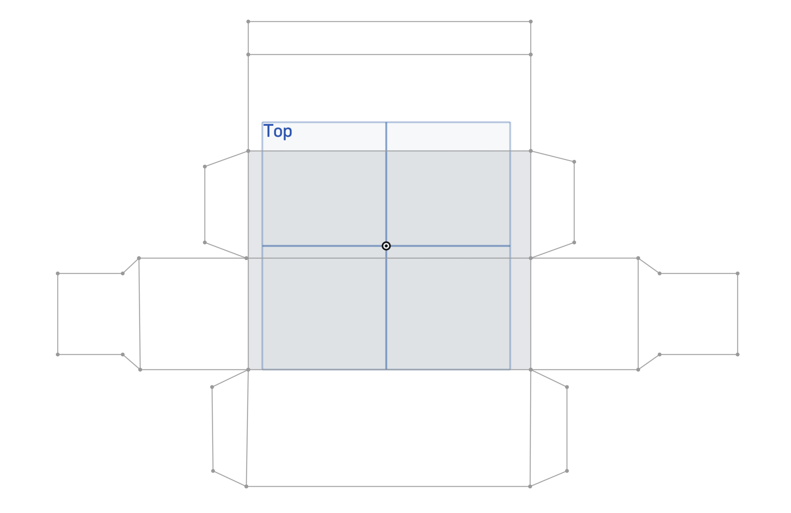
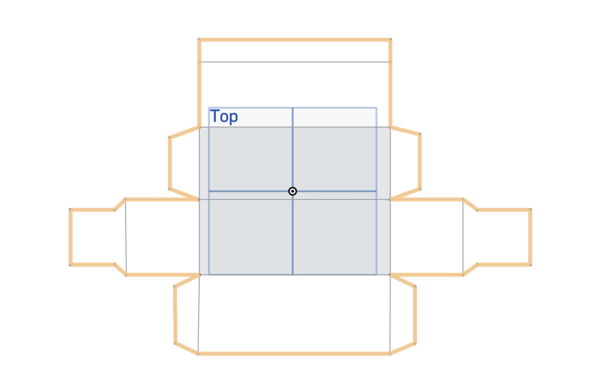
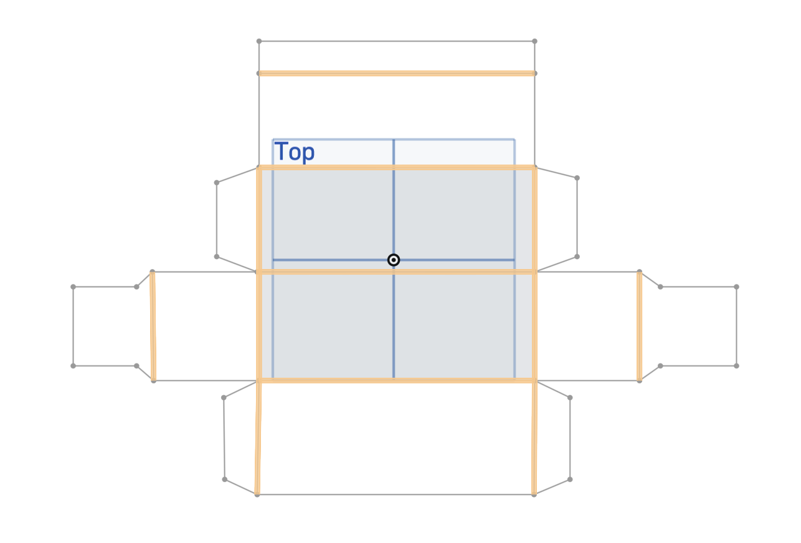

For this assignment, I designed a cardboard box for storing my rocket. I created the box template in Onshape and prepared it for laser cutting using xTool Creative Space.

## 1. Measuring the Reference Box

I started by measuring the sample box provided to us.

Because I wanted my rocket pieces to fit inside more comfortably, I increased the dimensions slightly when designing my own box.

## 2. Drawing the Box Template

I created the box template in Onshape using the Sketch and Line tools.

I first drew the complete outer outline of the unfolded box, including its main faces and closing tabs.

I used sketch constraints, including the Coincident constraint, to connect the endpoints and keep the different sections aligned.

## 3. Separating the Cut Lines

The first sketch contained the outside edges of the box. These were the lines that needed to be completely cut by the laser cutter.

## 4. Creating the Score Lines

I created a second sketch for the folding lines.

This sketch contained only the lines where the cardboard needed to bend. These lines would be scored instead of completely cut.

Keeping the cut and score lines in separate sketches made it possible to give them different settings in the laser-cutting software.

I used "dimension" tool in both sketches to makes sure the measurements were exactly accurate with what I wanted.

## 5. Sending the Files

I exported the two sketches as separate files and sent them to the school's 3dprint email.

One file contained the outer cutting lines, while the other contained the folding lines.

## 6. Preparing the Laser Cutter

I opened the files in xTool Creative Space.

For the material, I selected **Corrugated Cardboard**.

I assigned the operations as follows:

- The first sketch containing the outside edges was set to **Cut**.
- The second sketch containing the folding lines was set to **Score**.

## 7. Laser Settings

After researching suitable settings, I used:

| Operation | Power | Speed |
|---|---:|---:|
| Cut | 40% | 90 mm/s |
| Score | 15% | 120 mm/s |

The Cut setting was used to separate the box from the cardboard sheet. The Score setting marked the folding lines without cutting completely through the cardboard.

## Result

I prepared a custom-sized cardboard box template for my modular rocket. By separating the cutting and scoring lines, the box could be cut and folded correctly using the laser cutter.