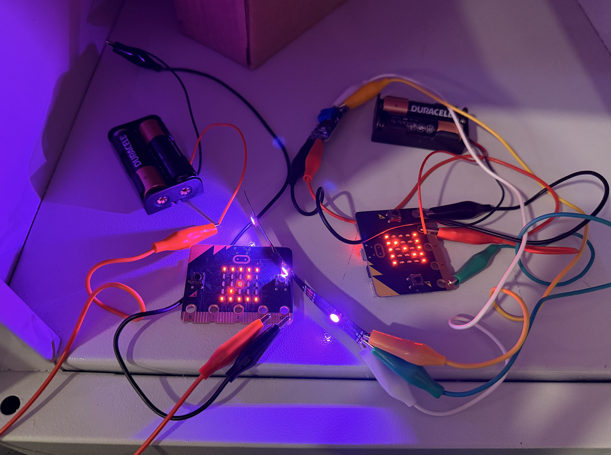
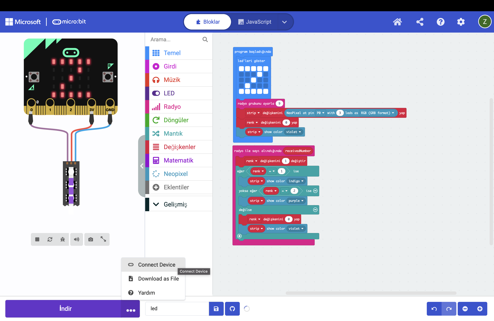
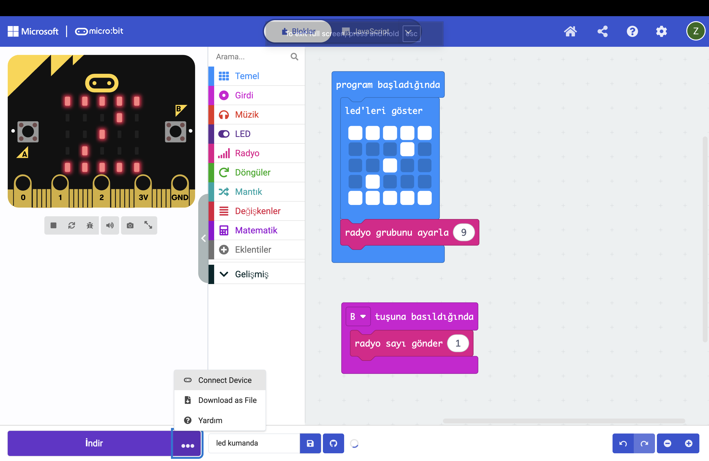
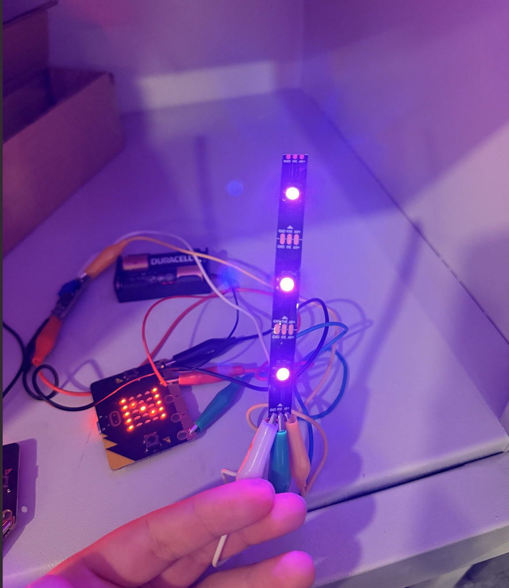

For this assignment, I created a wireless LED controller using two micro:bits. One micro:bit worked as a remote control, while the other received the radio signal and controlled a three-pixel NeoPixel LED.

Pressing button B on the remote changed the LED color between violet, indigo, and purple.

## 1. Connecting the First micro:bit

I first connected the micro:bit to my Mac using a USB cable. The micro:bit received power from the computer and turned on.

I completed the introductory activities provided by the micro:bit, such as pressing buttons A and B, shaking the device, and tilting it to interact with the built-in LED display.

## 2. Connecting the NeoPixel LED

I connected a three-pixel NeoPixel LED to the first micro:bit using three crocodile clip cables.

I used three different cable colors:

| Cable color | Purpose |
|---|---|
| Green | Data connection |
| Red | Positive voltage |
| Black | Ground |

The green data cable connected the micro:bit's `P0` pin to the LED's **Data In** connection.

It was important to connect the cable to **Data In** rather than **Data Out**, because the control signal needed to enter the first LED.

The red and black cables were used to provide power to the LED through the voltage converter.

## 3. Adjusting the Voltage Converter

The micro:bit provided approximately 3 V from its power pin, while the LED power connection was marked for 5 V.

For this reason, I used an adjustable voltage converter to increase the voltage from 3 V to 5 V.

I connected the micro:bit side to the voltage converter as follows:

- The red cable from the micro:bit was connected to **IN+**.
- The black cable from the micro:bit was connected to **IN-**.

Before connecting the output to the LED, I adjusted the voltage converter using a multimeter.

I connected the multimeter probes to the output cables:

- The red probe was connected to **OUT+**.
- The black probe was connected to **OUT-**.

I checked the voltage displayed on the multimeter and slowly turned the small adjustment screw on the voltage converter. I continued adjusting it until the multimeter displayed an output voltage of approximately **5 V**.

I didn't connect the LED until I was done with this process to make sure it didn't get damaged.

After setting the correct voltage, I connected the voltage converter output to the LED:

- A red cable was connected from **OUT+** to the LED's positive voltage input.
- A black cable was connected from **OUT-** to the LED's ground connection.

The green data cable remained connected directly between pin `P0` on the micro:bit and the **Data In** connection on the LED. The data cable did not pass through the voltage converter.

## 4. Connecting the micro:bit to MakeCode

I opened Microsoft MakeCode in Google Chrome and connected the micro:bit to my Mac using the USB cable.

In MakeCode, I clicked the three-dot menu beside the Download button and selected **Connect Device**. I then selected the connected micro:bit.

The direct connection feature uses WebUSB. On a Mac, this feature works in compatible Chromium-based browsers such as Google Chrome and Microsoft Edge.

When I tried to use Safari, the direct **Connect Device** option did not appear. For this reason, I used Google Chrome to connect the micro:bit and transfer the program directly.

Source: [micro:bit WebUSB troubleshooting](https://support.microbit.org/support/solutions/articles/19000105428-webusb-troubleshooting)

## 5. Programming the LED micro:bit

The first micro:bit was programmed as the radio receiver and LED controller.

Multiple students were working with micro:bits in the same classroom. To prevent the devices from receiving signals from other students' projects, each student was assigned a different radio group number.

My assigned radio group was `9`. I used group `9` in both the receiver and remote programs so that the two micro:bits could communicate with each other without interfering with the other projects in the classroom.

When the program started, it:

- Displayed the letter Z on the built-in LED matrix to confirm that the program had been transferred
- Set the radio group to `9`
- Created a NeoPixel strip on pin `P0`
- Set the number of LEDs to `3`
- Used the RGB GRB color format
- Created a color variable starting at `0`
- Set the initial LED color to violet

I added an **on radio received** block. Whenever the micro:bit received a radio number, the color variable increased by one.

The program changed the colors in this order:

1. Violet
2. Indigo
3. Purple
4. Back to violet

Instead of sending a different number for every color, I used only the number `1` as a trigger.

Every time the receiver detected the number `1`, it increased its own color variable and displayed the next color. This kept the radio communication simple because the remote only needed to send one command.

## 6. Programming the Remote micro:bit

After finishing the receiver program, I disconnected the first micro:bit and connected the second micro:bit to my Mac.

I connected it to MakeCode using the same **Connect Device** option and created a separate program for the remote control.

When the remote program started, it:

- Displayed the letter Z on the built-in LED matrix
- Set the radio group to `9`

I then added a **button B pressed** block. When button B was pressed, the micro:bit sent the radio number `1`.

Both micro:bits needed to use radio group `9`. Otherwise, the receiver would not detect the message sent by the remote.

## 7. Adding Battery Power

After transferring both programs, I disconnected the micro:bits from my computer.

I used two battery holders with two batteries in each holder, making four batteries in total.

### Powering the Remote micro:bit

For the remote control, I connected the battery holder using one red and one black crocodile clip cable.

- The red crocodile clip was connected to the red wire of the battery holder.
- The black crocodile clip was connected to the black wire of the battery holder.
- The other end of the red cable was connected to the micro:bit's `3V` pin.
- The other end of the black cable was connected to the micro:bit's `GND` pin.

### Powering the LED micro:bit

The LED micro:bit already had several crocodile clip cables connected, so I did not want to add more clips.

I used a wire cutter to expose a small section of the battery holder wires. I placed these exposed sections inside the existing crocodile clip connections used for the `3V` and `GND` pins.

- The positive battery wire was connected to the `3V` connection.
- The negative battery wire was connected to the `GND` connection.

I made sure that the exposed positive and negative wires did not touch each other because this could create a short circuit.

## 8. Testing the Wireless Controller

After powering both micro:bits with the battery holders, I tested the complete system.

Each time I pressed button B on the remote micro:bit, it sent the number `1` using radio group `9`.

The receiver detected the message, increased the color variable, and changed the NeoPixel color.

All three LEDs changed together in the following cycle:

**Violet → Indigo → Purple → Violet**

## Result

I successfully created a wireless LED controller using two micro:bits.

The remote micro:bit sent a radio signal whenever button B was pressed. The receiver micro:bit received the number `1` and used it as a trigger to move to the next LED color.

The three NeoPixel LEDs changed between violet, indigo, and purple. The project continued working after both micro:bits were disconnected from the computer and powered using separate battery holders.